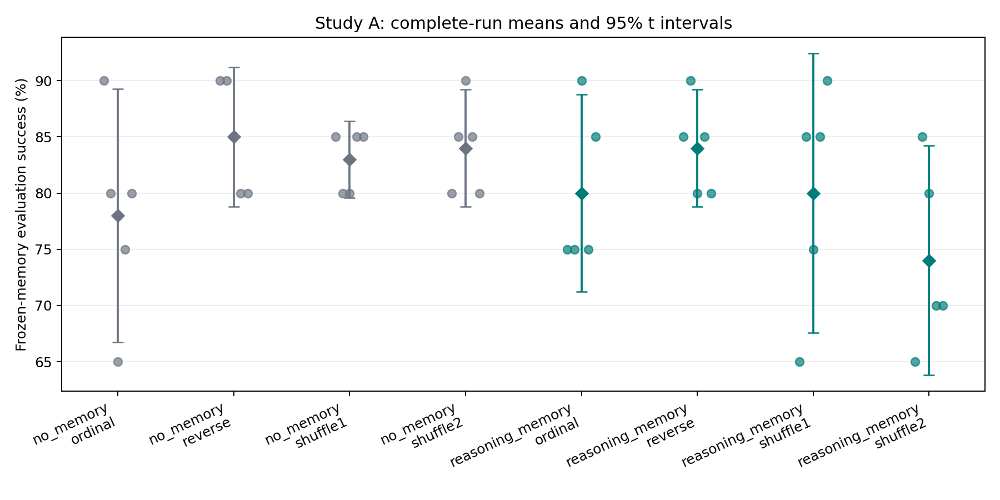
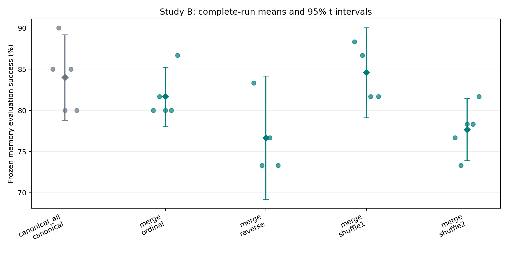

# 顺序效应实验报告

本报告基于实际完成的运行。主实验使用 DeepSeek-V4-Flash-0731-W8A8（campus，请求 reasoning effort high）；数据是 BFCL 的自定义跨任务划分，非原榜单评测。校园服务是否完整执行所有推理强度参数无法独立验证，已记录实际响应。

## 实验 A

完整运行：40；未完成运行：0；已完成运行返回的总词元：115,189,161；服务重试事件：516。

| 方法 | 顺序 | 独立运行数 | 测试成功率均值 | 运行间标准差 |
|---|---|---:|---:|---:|
| no_memory | ordinal | 5 | 78.0% | 9.1% |
| no_memory | reverse | 5 | 85.0% | 5.0% |
| no_memory | shuffle1 | 5 | 83.0% | 2.7% |
| no_memory | shuffle2 | 5 | 84.0% | 4.2% |
| reasoning_memory | ordinal | 5 | 80.0% | 7.1% |
| reasoning_memory | reverse | 5 | 84.0% | 4.2% |
| reasoning_memory | shuffle1 | 5 | 80.0% | 10.0% |
| reasoning_memory | shuffle2 | 5 | 74.0% | 8.2% |

预先指定的主要差值：-8.50 个百分点，95% 区间 [-21.51, +4.51]，双侧 p=0.1813。
区间覆盖零，当前样本不能可靠区分该差值与运行波动。

## 实验 B

完整运行：23；未完成运行：1；已完成运行返回的总词元：85,332,152；服务重试事件：32。

| 方法 | 顺序 | 独立运行数 | 测试成功率均值 | 运行间标准差 |
|---|---|---:|---:|---:|
| canonical_all | canonical | 5 | 84.0% | 4.2% |
| merge | ordinal | 5 | 81.7% | 2.9% |
| merge | reverse | 4 | 76.7% | 4.7% |
| merge | shuffle1 | 4 | 84.6% | 3.4% |
| merge | shuffle2 | 5 | 77.7% | 3.0% |

预先指定的主要差值：-0.54 个百分点，95% 区间 [-4.38, +3.30]，双侧 p=0.7563。
区间覆盖零，当前样本不能可靠区分该差值与运行波动。

## 解释边界

A 的主要差值是记忆与无记忆条件下 shuffle−ordinal 差值的差，不是单独的 shuffle 成功率。B 的单位是独立构建的记忆；同一记忆的三次评估先取平均。所有结论条件于固定任务集，不能把几十道测试题算成几十次独立进化重复。

适配方法是 ReasoningBank 风格与自定义顺序融合器，不是 ReasoningBank/ACE 原论文复现。原始顺序不等于难度课程。公开数据可能已被模型训练使用；网关模型别名和部分服务端随机性无法完全锁定。服务失败未返回的词元、失败开发运行及固定经验池抽取费用不包含在上述已完成运行合计中。

详细协议见 PROTOCOL.md；每组的原始运行值、探索性检验及 Holm 校正在 statistics_*.json；逐运行表见 runs_*.csv。
